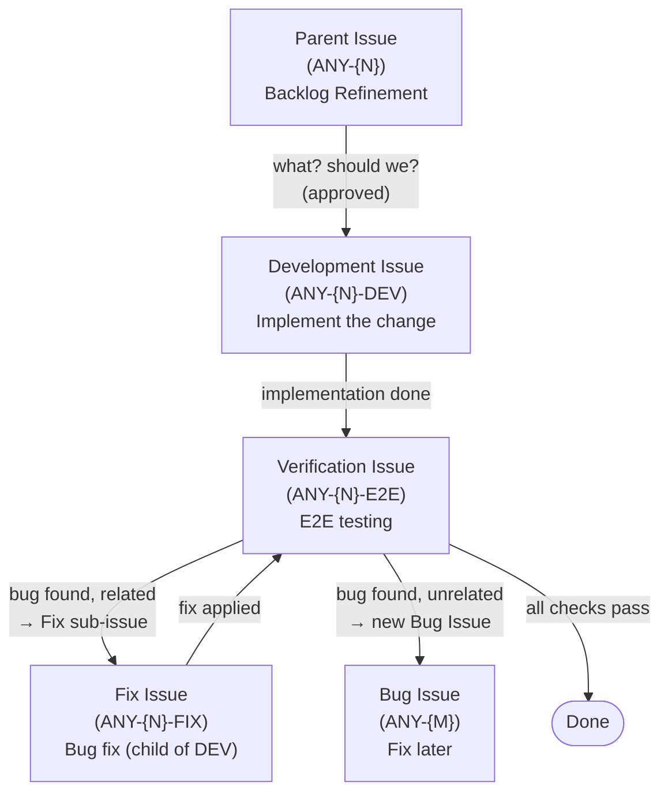

# AnyWear Issue Workflow

Paperclip issue-level orchestration for the AnyWear project. Every piece of
work moves through exactly three issue types: a **parent (main) issue** for
Backlog Refinement, a **Development** child issue, and a **Verification (E2E)**
child issue.

## Engineering Cybernetics

This workflow is designed as a **feedback control system** — a core idea from
Engineering Cybernetics. Rather than a linear "plan → build → ship" pipeline,
it operates as a closed loop where the output is continuously measured against
the desired outcome and corrections are fed back into the process.

```
                   ┌─────────── correction signal ───────────┐
                   │                                          │
    ┌─────────┐    │    ┌──────────┐     ┌──────────────┐     │
    │ Setpoint │────┼───▶│ Controller│────▶│   Process    │─────┼───▶ Output
    │ (Specs)  │    │    │  (Dev)   │     │(Code change) │     │
    └──────────┘    │    └──────────┘     └──────────────┘     │
                    │                                          │
                    │    ┌──────────┐     ┌──────────────┐     │
                    └────│ Feedback │◀────│   Sensor     │◀────┘
                         │(Bug fix) │     │ (E2E Verify) │
                         └──────────┘     └──────────────┘
```

| Control Term | Workflow Equivalent |
|---|---|
| **Setpoint** | Backlog Refinement — acceptance criteria define the desired state |
| **Controller** | Development issue — produces the change |
| **Process** | Code change in the repositories |
| **Sensor** | Verification issue (E2E) — measures actual output against setpoint |
| **Feedback** | Bug reports flow back to Development for correction |
| **Correction signal** | Related bugs spawn a Fix sub-issue of the dev issue; unrelated bugs create new issues |

This closed-loop structure means the system is **self-correcting**: every
iteration through the verification → development loop brings the output closer
to the setpoint. Work is never "done" until the sensor confirms the output
matches the specification.

## Workflow Diagram



## Issue Structure

Every unit of work uses a parent issue with two child issues.

### Parent Issue (Main Issue)

The entry point. Its only job is **Backlog Refinement** — answering two
questions before any code is written:

1. **What do we want to do?** — define the change clearly.
2. **Should we do it?** — is it worth doing now?

The parent issue holds a short refinement document with:

- Problem statement
- Proposed solution (high-level, which repos are affected)
- Scope (in/out)
- Acceptance criteria
- Decision: what and should we?

Only after the refinement is approved does the parent issue spawn the
development child.

**Status flow**: `backlog` → `todo` → `in_progress` (refinement) → `in_review`
(approval) → spawns children → `in_progress` (tracking children) → `done` (when
both children complete).

### Development Issue (Child)

Implements the change defined in the parent's refinement. Works in the
AnyWear repositories (`AnyWear-Client/`, `AnyWear-Service/`, `AnyWear-Meta/`).

**Creation**: `POST /api/companies/{companyId}/issues` with:
- `parentId`: the parent issue ID
- `goalId`: same as parent's `goalId`
- `title`: derived from parent (`"{parent-title} — Development"`)
- `blockedByIssueIds`: empty (starts immediately after parent approval)

**Status flow**: `todo` → `in_progress` → `done` (when implementation complete
and all scripted tests pass).

### Verification Issue (Child)

Runs E2E testing against the completed development. Uses the
`autonomous-e2e-test` skill approach — Playwright-driven browser testing of the
AnyWear Client web layer.

**Creation**: created at the same time as the Development issue, but starts with
`blockedByIssueIds: [<dev-issue-id>]` so it waits for development to finish.

**Status flow**: `blocked` (waiting for dev) → `todo` (dev done) → `in_progress`
→ branches based on outcome:

| Outcome | Action |
|---------|--------|
| All E2E checks pass | → `done` |
| Bug found, related to this change | → create a **Fix Issue** as a child of the dev issue, set `blockedByIssueIds: [<fix-issue-id>]`, add comment with findings |
| Bug found, unrelated to this change | → create a new **Bug Issue**, link it to the parent, set verification to `done` |

## Bug Handling

When the Verification issue finds a bug, determine if it's related to the
current parent issue:

### Related Bug
The bug is a regression or flaw in the feature being built. Create a **Fix
Issue** as a child of the Development issue — this preserves the dev issue as
a clean record of the initial implementation and follows Paperclip's
forward-moving lifecycle:

```json
POST /api/companies/{companyId}/issues
{
  "title": "Fix: <bug description>",
  "description": "<reproduction steps, observed behavior, expected behavior>",
  "status": "todo",
  "priority": "high",
  "parentId": "<dev-issue-id>",
  "goalId": "<same-goal-id>"
}

PATCH /api/issues/{e2e-issue-id}
{ "status": "blocked", "blockedByIssueIds": ["<fix-issue-id>"] }
```

Add a comment on the verification issue describing the bug and linking to
the fix issue. When the fix is done, the e2e issue auto-unblocks via
`issue_blockers_resolved` and verification reruns.

This pattern gives you a clean audit trail: what was built (dev issue) →
what was found (e2e comment) → what was fixed (fix sub-issue) →
that it passed (e2e done).

### Unrelated Bug
The bug exists in the codebase but is not caused by or related to the
current change. Create a standalone bug issue:

```json
POST /api/companies/{companyId}/issues
{
  "title": "Bug: <description>",
  "description": "<reproduction steps, observed behavior, expected behavior>",
  "status": "backlog",
  "priority": "medium",
  "parentId": "<parent-issue-id>",
  "goalId": "<same-goal-id>"
}
```

The current verification issue can then be marked `done` — the unrelated
bug is tracked separately for future work.

## Lifecycle Summary

```
Parent (backlog/todo) → Refinement (in_progress) → Approval (in_review)
  → Spawn: Dev (todo) + E2E (blocked on Dev)
  → Dev (in_progress → done)
  → E2E (todo → in_progress)
    → Pass: Parent + E2E → done
    → Related fail: Fix issue created (child of dev, todo), E2E blocked → fix done → retest
    → Unrelated fail: Bug issue created (backlog), E2E → done
```

## Key Rules

1. **Backlog refinement first** — answer "what?" and "should we?" before
   creating development/verification issues.
2. **Parent → children** — the parent spawns exactly two children: one
   Development, one Verification.
3. **E2E gates completion** — no issue is done until verification passes or an
   unrelated bug is extracted.
4. **Related bugs spawn Fix sub-issues** — create a `Fix: {bug}` issue as a child of the dev issue. Never reopen a `done` dev issue — this preserves a clean forward audit trail.
5. **Unrelated bugs are separate issues** — capture them in the backlog, don't
   block the current work.
6. **Blockers are first-class** — use `blockedByIssueIds` to express the
   dev → e2e dependency, not free-text comments.

## Cross-References

- `autonomous-e2e-test` skill — Playwright-based E2E testing of the client web layer
- `git-submodule-ops` skill — submodule pull/commit/push/merge commands
