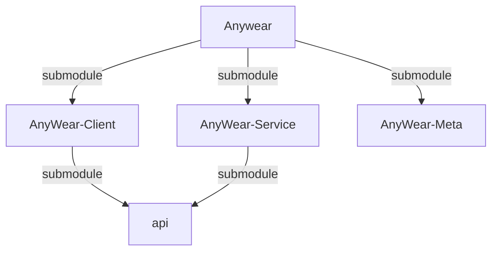

# Agents Context & Repository Structure

This root directory is a **shell repository** containing three Git submodules. **Do not run build or install commands in the root directory.** All code and package configuration lives in the subdirectories.

1. **Client Repository**: `AnyWear-Client/` (Tauri / React Frontend)
2. **Service Repository**: `AnyWear-Service/` (Node.js / Hono Backend)
3. **Meta Repository**: `AnyWear-Meta/` (Source of truth for documentation and shared TypeScript interfaces)

## Git & Submodule Operations

- Run `git submodule update --init --recursive` if directories are empty or missing.
- **Git Commits**: Since each directory is an independent Git repository, you must execute `git` operations (add, commit, push) *inside* the specific subdirectory (`AnyWear-Client`, `AnyWear-Service`, or `AnyWear-Meta`). Committing at the root only updates the submodule commit pointers.
- **Meta Updates**: When `AnyWear-Meta` is updated, remember that the submodule pointers in `AnyWear-Client`, `AnyWear-Service`, and the root repository may need to be updated and committed to point to the new meta commit.

## Design & Documentation

When designing new features, making architectural decisions, or updating system behaviors, always add or update the corresponding design documents in `AnyWear-Meta/architecture/`. Architecture Decision Records (ADRs) should be documented in `AnyWear-Meta/architecture/ADR/`.

## Parallel Execution

Frontend and backend tasks can usually be executed in parallel. 

When working on full-stack features or changes that span codebases, utilize sub-agents to maximize efficiency:
- **Client Agent**: Use a sub-agent dedicated to tasks within the `AnyWear-Client` directory.
- **Service Agent**: Use a sub-agent dedicated to tasks within the `AnyWear-Service` directory.
- **Meta Agent**: Use a sub-agent for OpenAPI or shared interface updates within the `AnyWear-Meta` directory.

By spawning parallel agents, you can concurrently implement features, resolve bugs, and run isolated git operations across repositories.

## Repository Dependency Relations

