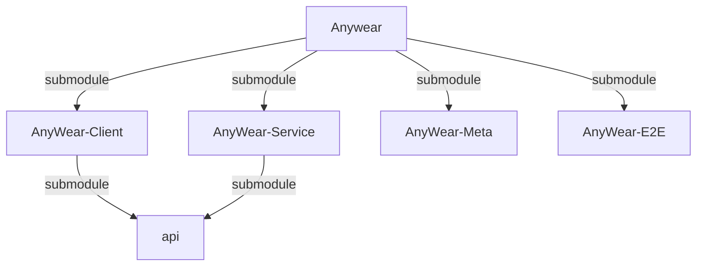
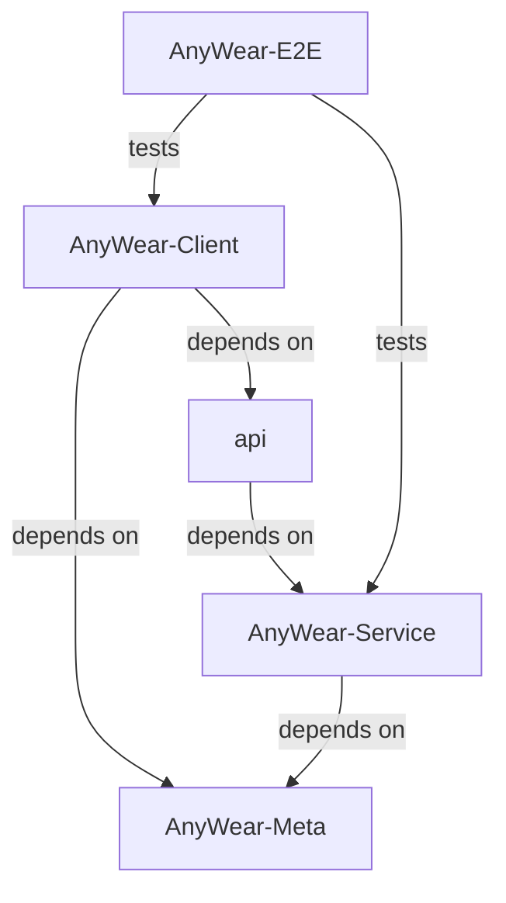

# About Agents Context & Repository Structure

> **Note:** There are specific agent instruction files for each submodule. Be sure to also reference them when working in their respective directories:
> - `AnyWear-Meta/AGENTS.md`
> - `AnyWear-Client/AGENTS.md`
> - `AnyWear-Service/AGENTS.md`
> - `AnyWear-E2E/AGENTS.md`
> 
> 💡 **Tip:** For cross-project architecture principles and guidelines, read [`AnyWear-Meta/architecture/architecture_principles.md`](AnyWear-Meta/architecture/architecture_principles.md). For system design details, see the [application architecture](AnyWear-Meta/architecture/system-component-architecture/application-architecture/overview.md) and [technical architecture](AnyWear-Meta/architecture/system-component-architecture/technical-architecture/overview.md) overviews.

This root directory is a **shell repository** containing four Git submodules. **Do not run build or install commands in the root directory.** All code and package configuration lives in the subdirectories.

1. **Client Repository**: `AnyWear-Client/` (Tauri / React Frontend)
2. **Service Repository**: `AnyWear-Service/` (Node.js / Hono Backend)
3. **Meta Repository**: `AnyWear-Meta/` (Source of truth for documentation)
4. **E2E Repository**: `AnyWear-E2E/` (Cross-repository Playwright system tests)

## Repository Relations

### Submodule Relation

### Dependency Relation

## Workflow

Use the [kanban-workflow skill](.agents/skills/kanban-workflow/SKILL.md) to handle issues on the [AnyWear Kanban board](AnyWear-Meta/issues/kanban.md).

When a task names the `kanban_manager` role, coordinate the Kanban board and assign one `issue_worker` per issue. When a task names the `issue_worker` role, own that issue's complete lifecycle and delegate repository slices to `submodule_worker` agents. When a task names the `submodule_worker` role, stay within the assigned issue, repository, worktree, and scope and return evidence to the issue worker. Project-scoped custom agent files live under `.codex/agents/` and are automatically discovered by Codex.

## Subagent policy

- Use subagents proactively for independent, well-scoped tasks such as documentation, code exploration, testing, and review.
- Split work into parallel subagent tasks when doing so can improve turnaround time or coverage. Give each subagent the relevant context, scope, and acceptance criteria.
- The agent that owns a scope remains responsible for integrating child results, resolving conflicts inside that scope, running its final verification, and making its final decisions. The parent scope verifies the child report and handles cross-scope conflicts.
- Review all subagent changes before accepting them, and coordinate explicitly before delegating tightly coupled edits.

## Git & Submodule Operations

- Run `git submodule update --init --recursive` if directories are empty or missing.
- **Git Commits**: Since each directory is an independent Git repository, you must execute `git` operations (add, commit, push) *inside* the specific subdirectory (`AnyWear-Client`, `AnyWear-Service`, `AnyWear-Meta`, or `AnyWear-E2E`). Committing at the root only updates the submodule commit pointers.
- **Local Compatibility Workspace**: The root repository's four submodule pointers define a reproducible local workspace only. Full system E2E is owned by `AnyWear-E2E`, whose `compatibility.json` pins the exact Client and Service commits executed by CI. The root repository must not run CI or hold cross-repository credentials.

> ⚠️ **API Dependency Caution:** Both `AnyWear-Client` and `AnyWear-Service` reference the same remote `api` repo as a submodule, but with a strict producer/consumer relationship: **`AnyWear-Service` generates the API types, and `AnyWear-Client` only consumes them**. The update flow is always *Service generates → Client consumes* — never the reverse. If your task involves modifying these shared API types, make changes in `AnyWear-Service` first (it's the source of truth), and then update `AnyWear-Client`'s submodule pointer to pull in those changes. When working with parallel issues, be careful — two agents may introduce conflicting or inconsistent changes to the same API definitions. In such cases, handle the shared API changes first (or coordinate them explicitly in the issue descriptions), before creating parallel client/service issues.

## Code Exploration & Verification

- Do not use GitNexus tools, CLI commands, indexes, or skills for this project.
- Use `rg`, direct source inspection, language tooling, and repository documentation to understand code and trace execution flows.
- Before editing shared behavior, inspect callers, imports, API contracts, and relevant tests across the affected repositories. An empty text search does not prove a symbol is unused; consider dynamic dispatch and cross-language calls.
- When renaming or removing symbols, check definitions and references with language-aware tooling where available, review the diff, and verify affected behavior.
- Before committing, review `git diff`, run `git diff --check`, and complete the checks required by each changed submodule's instructions.
