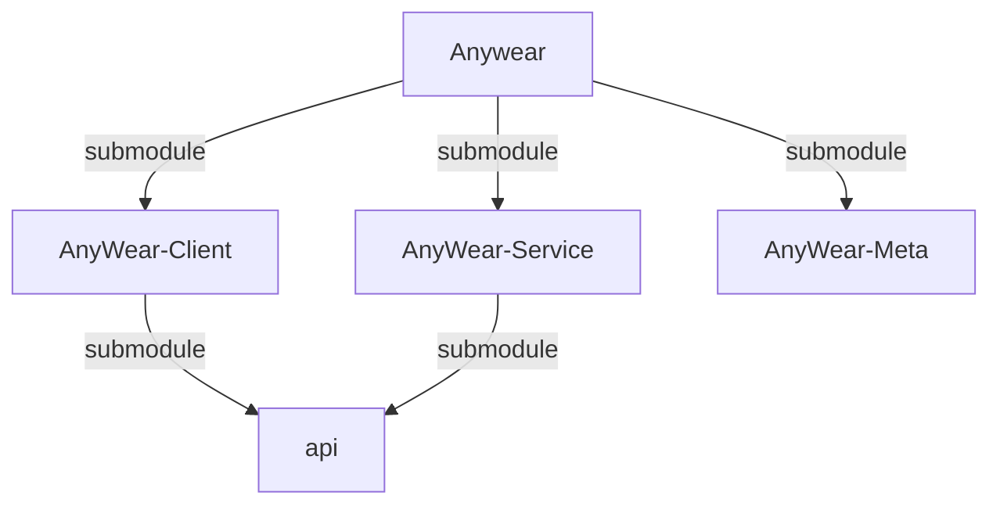
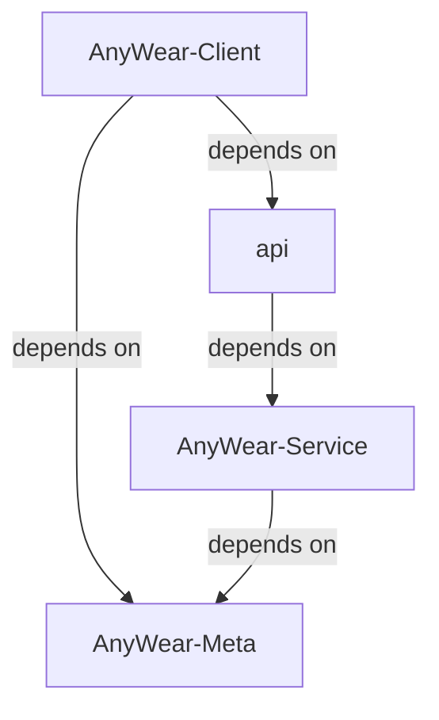

# About Agents Context & Repository Structure

> **Note:** There are specific agent instruction files for each submodule. Be sure to also reference them when working in their respective directories:
> - `AnyWear-Meta/AGENTS.md`
> - `AnyWear-Client/AGENTS.md`
> - `AnyWear-Service/AGENTS.md`
> 
> 💡 **Tip:** To get a comprehensive big picture of the entire project, please read [`AnyWear-Meta/architecture/overall_architecture.md`](AnyWear-Meta/architecture/overall_architecture.md).

This root directory is a **shell repository** containing three Git submodules. **Do not run build or install commands in the root directory.** All code and package configuration lives in the subdirectories.

1. **Client Repository**: `AnyWear-Client/` (Tauri / React Frontend)
2. **Service Repository**: `AnyWear-Service/` (Node.js / Hono Backend)
3. **Meta Repository**: `AnyWear-Meta/` (Source of truth for documentation)

## Repository Relations

### Submodule Relation

### Dependency Relation

## Git & Submodule Operations

- Run `git submodule update --init --recursive` if directories are empty or missing.
- **Git Commits**: Since each directory is an independent Git repository, you must execute `git` operations (add, commit, push) *inside* the specific subdirectory (`AnyWear-Client`, `AnyWear-Service`, or `AnyWear-Meta`). Committing at the root only updates the submodule commit pointers.

> ⚠️ **API Dependency Caution:** Both `AnyWear-Client` and `AnyWear-Service` reference the same remote `api` repo as a submodule, but with a strict producer/consumer relationship: **`AnyWear-Service` generates the API types, and `AnyWear-Client` only consumes them**. The update flow is always *Service generates → Client consumes* — never the reverse. If your task involves modifying these shared API types, make changes in `AnyWear-Service` first (it's the source of truth), and then update `AnyWear-Client`'s submodule pointer to pull in those changes. When working with parallel issues, be careful — two agents may introduce conflicting or inconsistent changes to the same API definitions. In such cases, handle the shared API changes first (or coordinate them explicitly in the issue descriptions), before creating parallel client/service issues.
