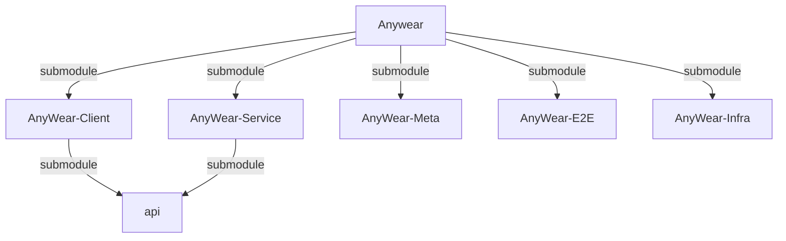
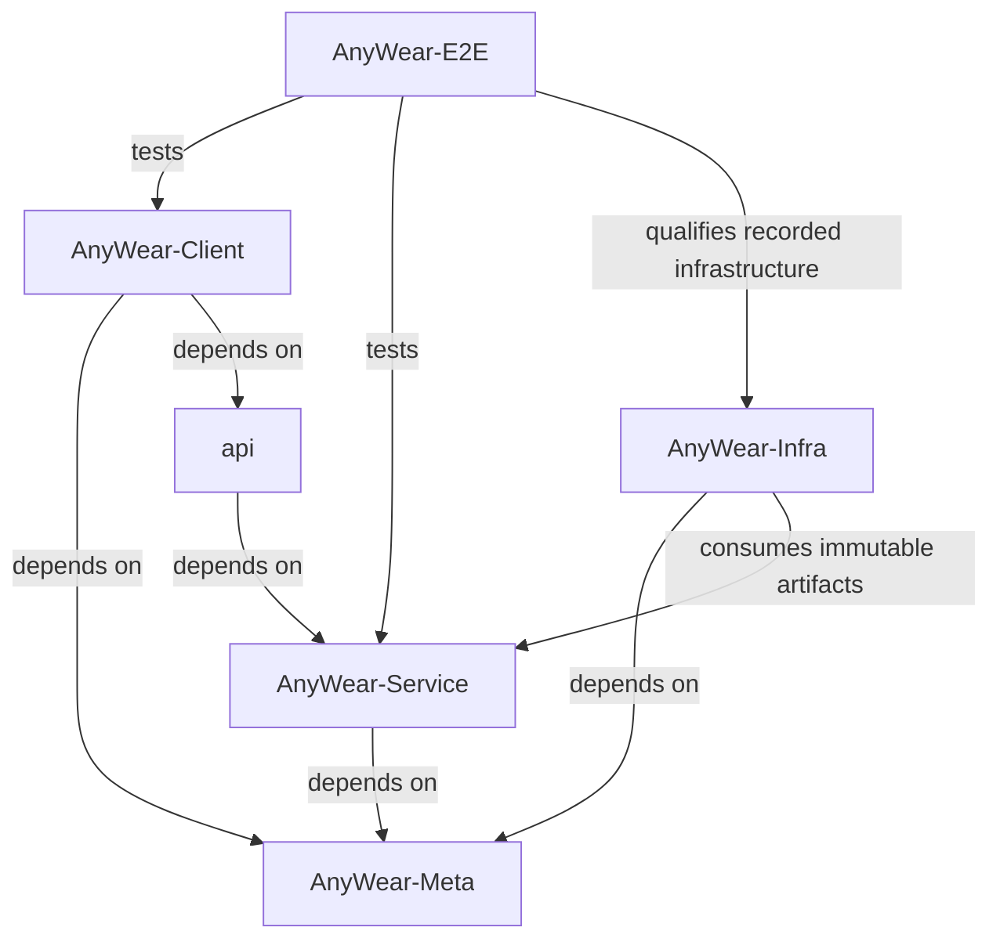

# About Agents Context & Repository Structure

> **Note:** There are specific agent instruction files for each submodule. Be sure to also reference them when working in their respective directories:
> - `AnyWear-Meta/AGENTS.md`
> - `AnyWear-Client/AGENTS.md`
> - `AnyWear-Service/AGENTS.md`
> - `AnyWear-E2E/AGENTS.md`
> - `AnyWear-Infra/AGENTS.md`
> 
> 💡 **Tip:** For cross-project architecture principles and guidelines, read [`AnyWear-Meta/architecture/architecture_principles.md`](AnyWear-Meta/architecture/architecture_principles.md). For system design details, see the [application architecture](AnyWear-Meta/architecture/system-component-architecture/application-architecture/overview.md) and [technical architecture](AnyWear-Meta/architecture/system-component-architecture/technical-architecture/overview.md) overviews.

This root directory is a **shell repository** containing five Git submodules. **Do not run build or install commands in the root directory.** All code and package configuration lives in the subdirectories.

1. **Client Repository**: `AnyWear-Client/` (Tauri / React Frontend)
2. **Service Repository**: `AnyWear-Service/` (Node.js / Hono Backend)
3. **Meta Repository**: `AnyWear-Meta/` (Source of truth for documentation)
4. **E2E Repository**: `AnyWear-E2E/` (Cross-repository Playwright system tests)
5. **Infra Repository**: `AnyWear-Infra/` (Shared AWS CDK source and infrastructure migration target)

## Infrastructure Responsibilities

The accepted [shared infrastructure ADR](AnyWear-Meta/architecture/ADR/0021-shared-infrastructure-repository.md) assigns shared infrastructure to `AnyWear-Infra`. Until the separately verified #54 cutover, `AnyWear-Service/infra` remains the deployed infrastructure authority. Registering or merging Infra source does not transfer the environment writer or establish runtime acceptance.

Service owns application code, Lambda source, database migrations, verification commands, generated API contracts and immutable Service artifacts. Infra consumes those artifacts using native release verification and a reviewed publication acceptance receipt; it does not generate API types or rebuild Service application artifacts. Client publishing stays independent, and E2E qualifies the recorded deployment tuple. Source delivery, artifact publication, native consumer acceptance, deployment and system qualification are separate gates.

Read [Infra source checks](AnyWear-Infra/AGENTS.md#required-source-checks), the [Beta runbook](AnyWear-Infra/docs/runbooks/beta-infrastructure.md) and the [cutover/recovery runbook](AnyWear-Infra/docs/runbooks/cutover-and-recovery.md) before assigned infrastructure work. Only the Kanban manager controls Beta on/off; starting or reactivating Beta requires the user's explicit consent under the [Beta lifecycle authority](.agents/skills/kanban-workflow/SKILL.md#beta-lifecycle-authority). An issue assignment or source pin does not grant deployment or lifecycle permission.

## Repository Relations

### Submodule Relation

### Dependency Relation

## Workflow

Use the [kanban-workflow skill](.agents/skills/kanban-workflow/SKILL.md) for [AnyWear Issues](https://github.com/git-malu/AnyWear/issues) and [Project #4](https://github.com/users/git-malu/projects/4). It owns roles, lifecycle gates, dependencies, and closure; its [GitHub operations reference](.agents/skills/kanban-workflow/references/github-operations.md) supplies commands and recovery procedures. Role definitions live in `.codex/agents/`.

Use the GitHub CLI (`gh`) for GitHub issues, pull requests, projects, and repository operations. Use the AWS CLI (`aws`) for AWS resources and deployments. Verify the active account, repository, and AWS region/profile before running commands.

## Subagent policy

- Use subagents proactively for independent, well-scoped tasks such as documentation, code exploration, testing, and review.
- Split work into parallel subagent tasks when doing so can improve turnaround time or coverage. Give each subagent the relevant context, scope, and acceptance criteria.
- The agent that owns a scope remains responsible for integrating child results, resolving conflicts inside that scope, running its final verification, and making its final decisions. The parent scope verifies the child report and handles cross-scope conflicts.
- Review all subagent changes before accepting them, and coordinate explicitly before delegating tightly coupled edits.

## Git & Submodule Operations

- Run `git submodule update --init --recursive` if directories are empty or missing.
- **Git Commits**: Since each directory is an independent Git repository, execute its `git` operations (add, commit, push) *inside* that repository (`AnyWear-Client`, `AnyWear-Service`, `AnyWear-Meta`, `AnyWear-E2E`, or `AnyWear-Infra`). Keep one Git writer per physical repository and stage only the allocated files. Root commits own shell documentation and submodule registration/pointers; they do not commit child repository contents.
- **Local Compatibility Workspace**: The root repository's five submodule pointers define a reproducible local workspace only. Full system E2E is owned by `AnyWear-E2E`, whose versioned `compatibility.json` defines its exact CI inputs. Root pins do not select a runtime or authorize artifact acceptance. The root repository must not own deployment pipelines, build/install commands, or cross-repository credentials; its existing comment-triggered agent workflow is not a system CI or deployment pipeline.

> ⚠️ **API Dependency Caution:** Both `AnyWear-Client` and `AnyWear-Service` reference the same remote `api` repo as a submodule, but with a strict producer/consumer relationship: **`AnyWear-Service` generates the API types, and `AnyWear-Client` only consumes them**. The update flow is always *Service generates → Client consumes* — never the reverse. If your task involves modifying these shared API types, make changes in `AnyWear-Service` first (it's the source of truth), and then update `AnyWear-Client`'s submodule pointer to pull in those changes. When working with parallel issues, be careful — two agents may introduce conflicting or inconsistent changes to the same API definitions. In such cases, handle the shared API changes first (or coordinate them explicitly in the issue descriptions), before creating parallel client/service issues.

## Code Exploration & Verification

- Use `rg`, direct source inspection, language tooling, and repository documentation to understand code and trace execution flows.
- Before editing shared behavior, inspect callers, imports, API contracts, and relevant tests across the affected repositories. An empty text search does not prove a symbol is unused; consider dynamic dispatch and cross-language calls.
- When renaming or removing symbols, check definitions and references with language-aware tooling where available, review the diff, and verify affected behavior.
- Before committing, review `git diff`, run `git diff --check`, and complete the checks required by each changed submodule's instructions.
