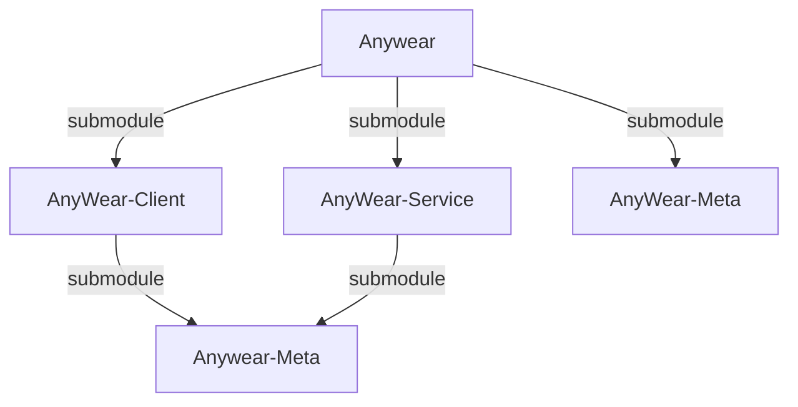

# Agents Context & Repository Structure

This directory contains two separate repositories, each with its own independent Git version control:

1. **Client Repository**: `AnyWear-Client/` (Frontend)
2. **Service Repository**: `AnyWear-Service/` (Backend)

## Parallel Execution

Since the frontend and backend are managed as separate repositories, development tasks for both can usually be executed in parallel. 

When working on full-stack features or changes that span both codebases, you should utilize sub-agents to maximize efficiency:
- **Client Agent**: Use a sub-agent dedicated to tasks within the `AnyWear-Client` directory.
- **Service Agent**: Use a sub-agent dedicated to tasks within the `AnyWear-Service` directory.

By spawning parallel agents for the client and service, you can concurrently implement features, resolve bugs, and run isolated git operations across both repositories.

## Repository Dependency Relations

