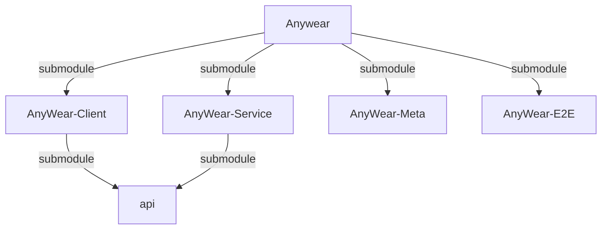
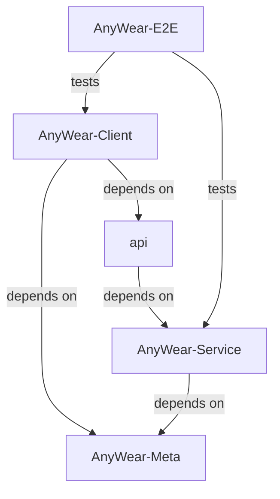

# About Agents Context & Repository Structure

> **Note:** There are specific agent instruction files for each submodule. Be sure to also reference them when working in their respective directories:
> - `AnyWear-Meta/AGENTS.md`
> - `AnyWear-Client/AGENTS.md`
> - `AnyWear-Service/AGENTS.md`
> - `AnyWear-E2E/AGENTS.md`
> 
> 💡 **Tip:** To get a comprehensive big picture of the entire project, please read [`AnyWear-Meta/architecture/overall_architecture.md`](AnyWear-Meta/architecture/overall_architecture.md).

This root directory is a **shell repository** containing four Git submodules. **Do not run build or install commands in the root directory.** All code and package configuration lives in the subdirectories.

1. **Client Repository**: `AnyWear-Client/` (Tauri / React Frontend)
2. **Service Repository**: `AnyWear-Service/` (Node.js / Hono Backend)
3. **Meta Repository**: `AnyWear-Meta/` (Source of truth for documentation)
4. **E2E Repository**: `AnyWear-E2E/` (Cross-repository Playwright system tests)

## Repository Relations

### Submodule Relation

### Dependency Relation

## Git & Submodule Operations

- Run `git submodule update --init --recursive` if directories are empty or missing.
- **Git Commits**: Since each directory is an independent Git repository, you must execute `git` operations (add, commit, push) *inside* the specific subdirectory (`AnyWear-Client`, `AnyWear-Service`, `AnyWear-Meta`, or `AnyWear-E2E`). Committing at the root only updates the submodule commit pointers.
- **Local Compatibility Workspace**: The root repository's four submodule pointers define a reproducible local workspace only. Full system E2E is owned by `AnyWear-E2E`, whose `compatibility.json` pins the exact Client and Service commits executed by CI. The root repository must not run CI or hold cross-repository credentials.

> ⚠️ **API Dependency Caution:** Both `AnyWear-Client` and `AnyWear-Service` reference the same remote `api` repo as a submodule, but with a strict producer/consumer relationship: **`AnyWear-Service` generates the API types, and `AnyWear-Client` only consumes them**. The update flow is always *Service generates → Client consumes* — never the reverse. If your task involves modifying these shared API types, make changes in `AnyWear-Service` first (it's the source of truth), and then update `AnyWear-Client`'s submodule pointer to pull in those changes. When working with parallel issues, be careful — two agents may introduce conflicting or inconsistent changes to the same API definitions. In such cases, handle the shared API changes first (or coordinate them explicitly in the issue descriptions), before creating parallel client/service issues.

<!-- gitnexus:start -->
# GitNexus — Code Intelligence

This project is indexed by GitNexus as **AnyWear** (9399 symbols, 19412 relationships, 300 execution flows). Use the GitNexus MCP tools to understand code, assess impact, and navigate safely.

> Index stale? Run `node .gitnexus/run.cjs analyze` from the project root — it auto-selects an available runner. No `.gitnexus/run.cjs` yet? `npx gitnexus analyze` (npm 11 crash → `npm i -g gitnexus`; #1939).

## Always Do

- **MUST run impact analysis before editing any symbol.** Before modifying a function, class, or method, run `impact({target: "symbolName", direction: "upstream"})` and report the blast radius (direct callers, affected processes, risk level) to the user.
- **MUST run `detect_changes()` before committing** to verify your changes only affect expected symbols and execution flows. For regression review, compare against the default branch: `detect_changes({scope: "compare", base_ref: "main"})`.
- **MUST warn the user** if impact analysis returns HIGH or CRITICAL risk before proceeding with edits.
- When exploring unfamiliar code, use `query({search_query: "concept"})` to find execution flows instead of grepping. It returns process-grouped results ranked by relevance.
- When you need full context on a specific symbol — callers, callees, which execution flows it participates in — use `context({name: "symbolName"})`.
- For security review, `explain({target: "fileOrSymbol"})` lists taint findings (source→sink flows; needs `analyze --pdg`).

## Never Do

- NEVER edit a function, class, or method without first running `impact` on it.
- NEVER ignore HIGH or CRITICAL risk warnings from impact analysis.
- NEVER rename symbols with find-and-replace — use `rename` which understands the call graph.
- NEVER commit changes without running `detect_changes()` to check affected scope.

## Resources

| Resource | Use for |
|----------|---------|
| `gitnexus://repo/AnyWear/context` | Codebase overview, check index freshness |
| `gitnexus://repo/AnyWear/clusters` | All functional areas |
| `gitnexus://repo/AnyWear/processes` | All execution flows |
| `gitnexus://repo/AnyWear/process/{name}` | Step-by-step execution trace |

## CLI

| Task | Read this skill file |
|------|---------------------|
| Understand architecture / "How does X work?" | `.opencode/skills/gitnexus/gitnexus-exploring/SKILL.md` |
| Blast radius / "What breaks if I change X?" | `.opencode/skills/gitnexus/gitnexus-impact-analysis/SKILL.md` |
| Trace bugs / "Why is X failing?" | `.opencode/skills/gitnexus/gitnexus-debugging/SKILL.md` |
| Rename / extract / split / refactor | `.opencode/skills/gitnexus/gitnexus-refactoring/SKILL.md` |
| Tools, resources, schema reference | `.opencode/skills/gitnexus/gitnexus-guide/SKILL.md` |
| Index, status, clean, wiki CLI commands | `.opencode/skills/gitnexus/gitnexus-cli/SKILL.md` |

<!-- gitnexus:end -->
