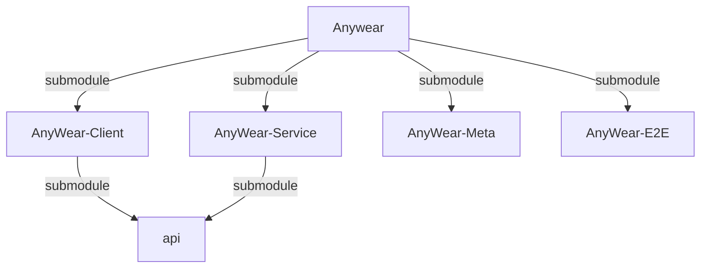
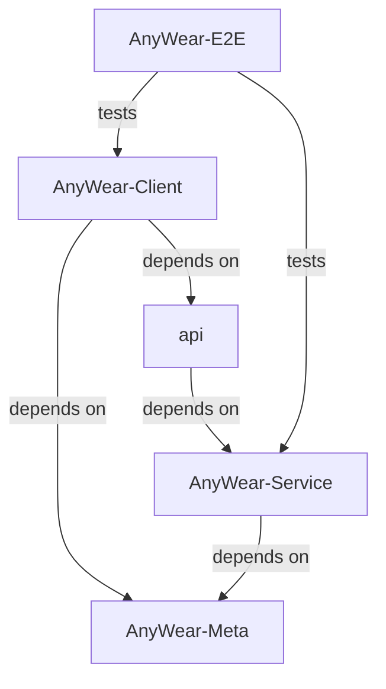

# About Agents Context & Repository Structure

> **Note:** There are specific agent instruction files for each submodule. Be sure to also reference them when working in their respective directories:
> - `AnyWear-Meta/AGENTS.md`
> - `AnyWear-Client/AGENTS.md`
> - `AnyWear-Service/AGENTS.md`
> - `AnyWear-E2E/AGENTS.md`
> 
> 💡 **Tip:** To get a comprehensive big picture of the entire project, please read [`AnyWear-Meta/architecture/overall_architecture.md`](AnyWear-Meta/architecture/overall_architecture.md).

This root directory is a **shell repository** containing four Git submodules. **Do not run build or install commands in the root directory.** All code and package configuration lives in the subdirectories.

1. **Client Repository**: `AnyWear-Client/` (Tauri / React Frontend)
2. **Service Repository**: `AnyWear-Service/` (Node.js / Hono Backend)
3. **Meta Repository**: `AnyWear-Meta/` (Source of truth for documentation)
4. **E2E Repository**: `AnyWear-E2E/` (Cross-repository Playwright system tests)

## Repository Relations

### Submodule Relation

### Dependency Relation

## Git & Submodule Operations

- Run `git submodule update --init --recursive` if directories are empty or missing.
- **Git Commits**: Since each directory is an independent Git repository, you must execute `git` operations (add, commit, push) *inside* the specific subdirectory (`AnyWear-Client`, `AnyWear-Service`, `AnyWear-Meta`, or `AnyWear-E2E`). Committing at the root only updates the submodule commit pointers.
- **Local Compatibility Workspace**: The root repository's four submodule pointers define a reproducible local workspace only. Full system E2E is owned by `AnyWear-E2E`, whose `compatibility.json` pins the exact Client and Service commits executed by CI. The root repository must not run CI or hold cross-repository credentials.

> ⚠️ **API Dependency Caution:** Both `AnyWear-Client` and `AnyWear-Service` reference the same remote `api` repo as a submodule, but with a strict producer/consumer relationship: **`AnyWear-Service` generates the API types, and `AnyWear-Client` only consumes them**. The update flow is always *Service generates → Client consumes* — never the reverse. If your task involves modifying these shared API types, make changes in `AnyWear-Service` first (it's the source of truth), and then update `AnyWear-Client`'s submodule pointer to pull in those changes. When working with parallel issues, be careful — two agents may introduce conflicting or inconsistent changes to the same API definitions. In such cases, handle the shared API changes first (or coordinate them explicitly in the issue descriptions), before creating parallel client/service issues.

<!-- gitnexus:start -->
# GitNexus — Code Intelligence

This project is indexed by GitNexus as **AnyWear** (24157 symbols, 54819 relationships, 943 execution flows).

> When running GitNexus analysis, use `gitnexus analyze --skip-agents-md --skip-skills` so it does not rewrite agent instructions or skills. If using the project-local runner, pass the same flags: `node .gitnexus/run.cjs analyze --skip-agents-md --skip-skills`. No local runner yet? Bootstrap with `npx`, `bunx`, or `pnpm dlx` and pass the same flags — e.g. `bunx gitnexus@latest analyze --skip-agents-md --skip-skills` (npm 11 npx crash; #1939).

## Always Do

- **MUST run impact before editing.** Use `impact({target: "symbolName", direction: "upstream"})` or `node .gitnexus/run.cjs impact "symbolName" --direction upstream --repo .`; report callers, processes, and risk. Never substitute grep for graph analysis.
- **MUST analyze graph changes before committing.** Use `detect_changes({scope: "all"})` (MCP) or `node .gitnexus/run.cjs detect-changes --scope all --repo .` (CLI fallback). `partial: true` or `truncated: true` is not a clean check — a zero means unseen, not unaffected; re-run it. For regression review: `detect_changes({scope: "compare", base_ref: "main"})` or `node .gitnexus/run.cjs detect-changes --scope compare --base-ref "main" --repo .`.
- MUST warn on HIGH/CRITICAL `risk` pre-edit; never use `riskSharedAxes` to waive a HIGH/CRITICAL `risk` warning. Compare File/symbol: MCP File omits axes; Graph-RAG expands File.
- **MUST treat `risk: UNKNOWN` as unresolved, not as low.** An empty caller set is not evidence the symbol is unused — it can also mean the callers are not resolvable by the index (plain-object property access, dynamic dispatch, cross-language calls). `impact` pairs `UNKNOWN` with a `riskNote` saying so. Confirm with a text search before treating the symbol as safe to change or delete; do not proceed on the strength of a zero.
- **MUST use `query({search_query: "concept"})` for concepts/flows, `context({name: "symbolName"})` for a named symbol, or `impact` for blast radius, on read-only callers, dependencies, imports, or execution flow.** Graph first; text search only for empty/`UNKNOWN`/literals.
- For security review, `explain({target: "fileOrSymbol"})` lists taint findings (source→sink flows; needs `analyze --pdg`).

## Never Do

- NEVER edit a function, class, or method before MCP/CLI impact analysis.
- NEVER ignore HIGH or CRITICAL risk warnings from impact analysis, and never read `UNKNOWN` as an all-clear — it means the walk could not answer, which is the one verdict that requires confirming by other means.
- NEVER rename symbols with find-and-replace — use `rename` which understands the call graph.
- NEVER commit before MCP/CLI graph change analysis.

## Resources

| Resource | Use for |
| --- | --- |
| `gitnexus://repo/AnyWear/context` | Codebase overview, check index freshness |
| `gitnexus://repo/AnyWear/clusters` | All functional areas |
| `gitnexus://repo/AnyWear/processes` | All execution flows |
| `gitnexus://repo/AnyWear/process/{name}` | Step-by-step execution trace |

## CLI

| Task | Read this skill file |
| --- | --- |
| Understand architecture / "How does X work?" | `.agents/skills/gitnexus-exploring/SKILL.md` |
| Blast radius / "What breaks if I change X?" | `.agents/skills/gitnexus-impact-analysis/SKILL.md` |
| Trace bugs / "Why is X failing?" | `.agents/skills/gitnexus-debugging/SKILL.md` |
| Rename / extract / split / refactor | `.agents/skills/gitnexus-refactoring/SKILL.md` |
| Tools, resources, schema reference | `.agents/skills/gitnexus-guide/SKILL.md` |
| Index, status, clean, wiki CLI commands | `.agents/skills/gitnexus-cli/SKILL.md` |

<!-- gitnexus:end -->
