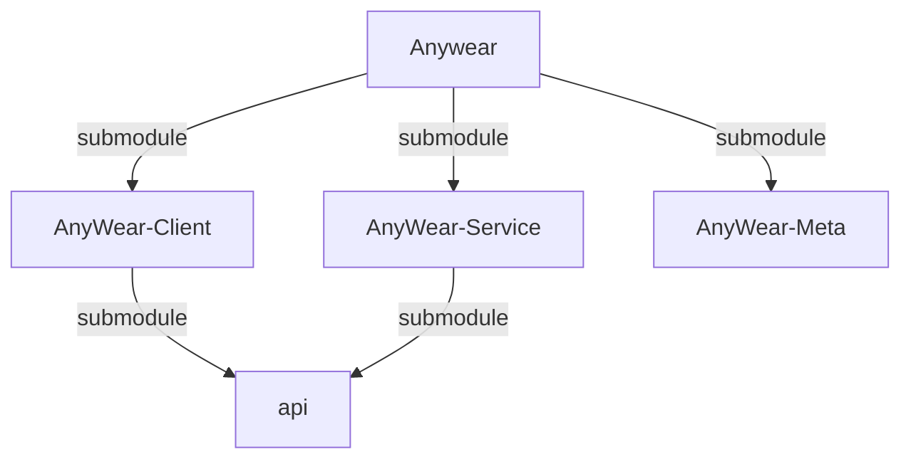

# Agents Context & Repository Structure

> **Note:** There are specific agent instruction files for each submodule. Be sure to also reference them when working in their respective directories:
> - `AnyWear-Meta/AGENTS.md`
> - `AnyWear-Client/AGENTS.md`
> - `AnyWear-Service/AGENTS.md`
> 
> 💡 **Tip:** To get a comprehensive big picture of the entire project, please read [`AnyWear-Meta/architecture/overall_architecture.md`](AnyWear-Meta/architecture/overall_architecture.md).

This root directory is a **shell repository** containing three Git submodules. **Do not run build or install commands in the root directory.** All code and package configuration lives in the subdirectories.

1. **Client Repository**: `AnyWear-Client/` (Tauri / React Frontend)
2. **Service Repository**: `AnyWear-Service/` (Node.js / Hono Backend)
3. **Meta Repository**: `AnyWear-Meta/` (Source of truth for documentation and shared TypeScript interfaces)

## Repository Dependency Relations

## Standard Workflow

Follow the full development workflow documented in [`AnyWear-Meta/AGENTS.md`](AnyWear-Meta/AGENTS.md#1-standardized-agent-workflows):

## Git & Submodule Operations

- Run `git submodule update --init --recursive` if directories are empty or missing.
- **Git Commits**: Since each directory is an independent Git repository, you must execute `git` operations (add, commit, push) *inside* the specific subdirectory (`AnyWear-Client`, `AnyWear-Service`, or `AnyWear-Meta`). Committing at the root only updates the submodule commit pointers.

## Parallel Sub-Agent Strategy

When a task involves significant changes to **both** the frontend (`AnyWear-Client`) and backend (`AnyWear-Service`) simultaneously, launch two sub-agents in parallel to work on each repository independently. This saves time by overlapping work instead of serial execution.

- Use this strategy for high-workload tasks touching both repositories.
- Each sub-agent should be given a clear, scoped prompt targeting its specific repository.
- After both complete, verify changes in each repository with build/lint/test commands.

> ⚠️ **API Dependency Caution:** Both `AnyWear-Client` and `AnyWear-Service` share an `api` submodule that defines their common TypeScript interfaces. If your task involves modifying these shared API types, be careful—the two parallel sub-agents may introduce conflicting or inconsistent changes to the same API definitions. In such cases, consider handling the shared API changes first (or coordinating them explicitly in the prompts), before spinning off the client/service work in parallel.
