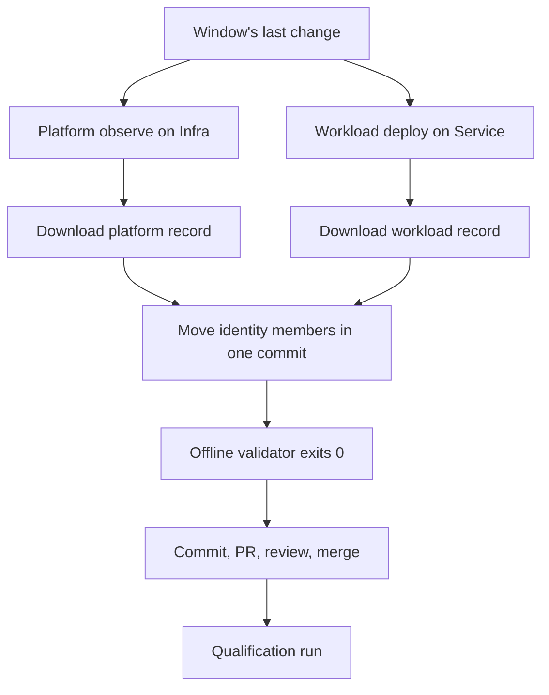

# Moving the system-test compatibility pin

`compatibility.json` is the system-test compatibility contract: it records the
deployed identity that Beta qualification accepts. Qualification refuses an
environment whose live tuple no longer matches it, so the pin has to move when the
deployed tuple moves.

This is the routine that moves it — the owner, the start condition, the two
observations that supply the values, the offline check that must pass before the
commit exists, and the qualification run that qualifies the merged pin. It is
written so a maintainer can perform a move without rediscovering the procedure,
and every step names the command to run or the exact field to read. The v3 shape
itself is documented in [compatibility-v3.md](compatibility-v3.md).

## Who owns moving it

The owner is the **`AnyWear-E2E` maintainers**. For one move, the owner is the
**E2E maintainer accountable for the change that moved the deployed tuple** — the
maintainer whose reviewed change produced the deployed tuple. That maintainer also
merges the pin commit, so one accountable person carries both the change and the
pin that describes it.

Two people are **not** the owner:

- the operator who dispatches the platform observation or the Service release
  chain — dispatching supplies evidence, it does not supply ownership;
- whoever runs qualification next — qualification consumes the pin, it does not
  decide it.

A hand re-pin with no work item behind it is **not permitted**. It has no owner,
no review, and no record of where its values came from. A tuple that changed with
nothing carrying it is a finding: qualification on that environment stops, and the
move waits for a work item that owns the change.

The window closes only on the user's word. The observations are user-authorised
actions, so nobody infers that the batch is finished because work went quiet.

## When the routine starts

The routine starts when a deployment, a configuration or admission window, or a
recovery changed the deployed tuple while no qualification was in flight.

Nothing fails at that moment. The environment is serving a coherent, working tuple
and only the evidence path is stale. The failure surfaces the next time
qualification is attempted, as a mismatch against a pin that describes the tuple
that used to be deployed.

**A Client publish counts.** Qualification compares the Client first and fails with
`Deployed Client does not match compatibility.json`, so a Client published after the
observation re-stales `client.sha` on its own, even when Service and Infra did not
move at all.

## Order of operations

The tuple has two producers. A move needs the record each producer wrote for the
tuple being pinned; one producer's record cannot stand in for the other.

1. **Platform record.** Run the reviewed Infra observation entry
   (`runtime.yml`) on reviewed Infra `main` at the revision that produced the
   Platform stack. It writes the v3 platform deployment record covering
   `AnyWearFoundationStack`, `AnyWearPlatformStack-beta` and
   `AnyWearBillingStack-beta`.
2. **Workload record.** Run the Service release chain
   (`service-artifacts.yml`, operation `deploy`) for the exact deployed Service
   commit. It builds and verifies the sealed release, deploys
   `AnyWearWorkloadStack-beta` and writes the workload deployment record covering
   only that stack. The record must be schema version 4 and carry the passed
   600-second six-signal bake gate; a record without it cannot be pinned.
3. **Download both artifacts.** The platform artifact is
   `infra-deployment-<run_id>-<run_attempt>` and contains exactly
   `deployment-record.json`. The workload artifact is
   `service-deployment-<run_id>-<run_attempt>` and contains exactly
   `service-deployment.json`.
4. **Move the identity members in one commit**, each value read from those two
   records.
5. **Validate offline.** The offline validator must pass before the commit exists.
6. **Commit, open the PR, review, merge.** The PR states, for each producer, the
   run/attempt/artifact and the record hash, and the value of each moved member:
   the table in this document is not the change, so a reviewer must be able to
   check the values against the records without reading the table.
7. **Record the evidence on the work item that owns the move**: both producer
   runs, the pin commit and the qualification run.

Never one producer at a time.



## Where each member is read from

Field paths are inside each downloaded record. `platform` and `workload` are the
two per-producer identities; `deployment` is the workload record identity.

| Member | Field path | Producer |
| --- | --- | --- |
| `client.sha` | platform record `observed.client_sha`; it must equal the HTTP Client build metadata | Infra |
| `service.sha` | workload record `observed.service_sha`; it must equal the HTTP Service health identity | Service |
| `infra.sha` | the reviewed Infra revision the E2E observation checks out | Infra |
| `platform.producer_sha` | platform record `producer.sha` | Infra |
| `platform.record.run_id`, `run_attempt` | platform record `producer.run_id`, `producer.run_attempt` | Infra |
| `platform.record.artifact_id` | **not in the record** | Infra |
| `platform.record.record_sha256` | the SHA-256 of the downloaded bytes (`sha256sum deployment-record.json`) | Infra |
| `workload.producer_sha` | workload record `producer.sha` (the Service commit) | Service |
| `deployment.run_id`, `run_attempt` | workload record `producer.run_id`, `producer.run_attempt` | Service |
| `deployment.artifact_id` | **not in the record** | Service |
| `deployment.record_sha256` | the SHA-256 of the downloaded bytes (`sha256sum service-deployment.json`) | Service |
| `service_artifacts` | the sealed release/asset identity the workload record's image belongs to | Service |

The artifact ids are read by hand from each run page; the records do not carry
them. The record hash is the hash of the exact downloaded bytes: the producers
write single-line canonical JSON, so reformatting a file changes the hash.

## Deferred records

The committed v3 pin is **deferred** for both producers until the first authorized
deployment/observe rounds exist. On the Service side a pinnable record must be
schema version 4 with its passed 600-second six-signal bake, so the deferred
reason names the missing v4 gated record rather than the release chain itself.
The deferred shape names the producer and its reviewed workflow but claims no run:

```json
"deployment": {
  "producer": "git-malu/AnyWear-Service",
  "workflow_path": ".github/workflows/service-artifacts.yml",
  "status": "deferred",
  "reason": "no Service release-chain v4 deployment record exists yet; the first authorized gated deploy supplies the passed 600 s six-signal bake gate and the record identity (run_id, run_attempt, artifact_id, record_sha256)"
}
```

A deferred pin is honest and reviewable, but it is not qualification authority:
every live path fails closed with `deployment evidence deferred`, and the offline
validator refuses to move a deferred pin. The first move fills both identities
with the recorded shape, and only real downloaded record bytes can supply it.

## The two-record rule

A pin describes one tuple. The tuple has four application/system parts plus two
recorded producer runs: a Client revision, a Service revision, an Infra observation
revision, the Service release the image belongs to, the platform record and the
workload record. One tuple, with no partial form.

> A change that moves one of these without the others leaves the pin describing a
> tuple that was never deployed. It will not pass, and it must not be committed.

Three places bind it, by symbol:

| Code | What it binds |
| --- | --- |
| `assertDeploymentBinding` in `scripts/trusted-deployment-inputs.mjs` | Begins with the exact shared-contract validation — the Infra v3 record, and the Service v4 record including its passed bake gate bound to the observed Service/image — then binds the record's producer (repository, commit, workflow, run and attempt), its per-stack producer identities, its observed Client (Infra) or Service/image (Service), the pinned producer, and the exact pin identity. |
| `validateInfraEvidence` in `scripts/qualification-record.mjs` | Re-asserts both records and the authenticated stage-base body at qualification time, before and after the suite; each record is validated for its own producer, and the HTTP identity binds the Client and Service pins to the two producers' observed tuples. |
| the rest of `scripts/trusted-deployment-inputs.mjs` | Refuses a deferred identity, an expired or differently shaped artifact, and a run that is not the reviewed producer before the suite. |

## What is not a substitute

Each of these is occasionally offered as a way to move the pin without the two
records. None of them is one.

- **A read-only state check.** A read-only Infra observe without a v3 record
  writes no deployment record and cannot move the pin.
- **The Infra Workload deploy entry.** Retired. An Infra run can no longer
  produce a record for `AnyWearWorkloadStack-beta`; that stack's record comes only
  from the Service release chain.
- **A Service publication run.** `service-artifacts.yml` publishes a sealed
  release; only its `deploy` operation deploys and writes the workload record,
  and a publication run's artifact is not a deployment record.
- **A hand-edited record.** Editing a field so the values fit dies on the byte
  hash: `record_sha256` is the hash of the downloaded bytes, and the validator
  compares bytes before it parses anything.
- **The historical v1 tool.** `scripts/migrate-compatibility.mjs` reads the
  historical v1 → v2 transition for audit only; the CLI rejects a v1 committed
  pin and never turns it into a v3 pin.
- **`pnpm check`.** On its own it validates the pin's shape, never its agreement
  with a record.

## Choosing the observation's inputs

The platform record comes from the reviewed Infra observation entry. Dispatch it
on reviewed Infra `main` at the revision that produced the deployed Platform
stack, after the stage switch allows the observation. Only the changed stack may
name the executor; every unchanged stack must name its real producer.

The workload record comes from the Service release chain's `deploy` operation for
the exact Service commit already published as a sealed release. The chain reads
the image digest and commit from its own build/verify outputs, asserts both stacks
are terminal, refuses a non-active Beta, deploys with the reviewed identity phase
and writes the v4 record after `cdk deploy` from `ssm get-parameters` and
`describe-stacks`. The record must include the passed 600-second six-signal bake
gate; this consumer refuses it otherwise, so a failed or incomplete bake can
never supply a pinnable record.

Both artifacts are retained for ninety days and the live binding refuses an
expired one, so the pin must move while both records still exist.

The Platform → Workload deploy ordering is **not claimed safe yet**, but the
producer-side fix is approved. C's post-C Platform deploy removes every
`PublishOutput*` output, and the release-slice deploy's last eleven weak reads
(nine cleanup values and two isolated-subnet values) are being converted into
stage-contract parameters. The Service record's `inputs[]` grows to whatever the
deployed phase reads — expected 38 for resident active `roles-added` (34
stage-base parameters + 4 reused values; the stopped-only `isolated_subnet_ids`
is not read at that phase). This consumer accepts the recorded, sorted and
unique list without a count or name assertion, so no schema or format change
follows. Once both stacks read pure SSM parameters, deploy order no longer
matters. Until the deferred Foundation/Platform round supplies those parameters
and the first records, there is no live qualification and no Workload deploy.

## The offline validator

`scripts/validate-compatibility-pin.mjs`, exposed as `pnpm compatibility:pin`. No
token, no network, no AWS.

```bash
node scripts/validate-compatibility-pin.mjs \
  --platform-record .qualification-inputs/platform-deployment-record.json \
  --deployment-record .qualification-inputs/deployment-record.json \
  --previous .qualification-inputs/previous-compatibility.json
```

`--compatibility` defaults to the committed `compatibility.json` beside the script rather than to the working directory, so the check reads the reviewed pin wherever it is invoked.

What it asserts, in order:

1. The pin is v3 and neither record identity is deferred.
2. Each record's byte hash equals its `record_sha256`. Files are read as bytes and
   never re-serialised, pretty-printed or parse-then-hashed.
3. `assertDeploymentBinding` holds for both records — producer, per-stack
   producer identities, the observed Client and Service, the v4 Service record's
   passed bake gate (600-second window, six fixed signals, gate Service/image equal
   to the observed tuple), and the platform/workload producer pins.
4. Each record's producer identity (repository, commit, workflow, run and
   attempt), stack set, stage-input set and observed identity match the pin. The
   two records are validated separately: their `observed` tuples are disjoint, so
   neither is compared with the other.
5. Against the previous pin: the pin moved (at least one of `client`, `service`,
   `infra`, `platform`, `workload`, `service_artifacts`, `deployment` changed).
   A changed record identity must move forward (a greater `run_id`, or the same
   `run_id` with a greater `run_attempt`); an unchanged identity is allowed when
   another member moved.
6. A v2 previous pin is read as the historical input of the strict v2 → v3
   migration; it imposes no run-order comparison across producers.

The documented hole: neither record carries its artifact id, so no offline input
constrains `platform.record.artifact_id` or `deployment.artifact_id`. The other
properties only the live GitHub API can supply are out of reach here too: each
run's conclusion, branch, dispatch type and head, each artifact's name and
lifetime, and the Service release's immutability and manifest bytes. Those stay
enforced at qualification time by `scripts/trusted-deployment-inputs.mjs`.

It is **not a gate**. The validator does not join `pnpm check`; only its test joins
the `test:core` list that `pnpm check` already runs. There is no new workflow, no
new required check and no new release gate. Green means the pin is coherent with
both records and with the previous pin — **coherence, not authority**.

## Checklist

One pass, end to end. Every step carries the command or the exact field to read.

1. Confirm the move has an owner and the window is over; the window closes only on the user's word. If either is missing, stop.
2. Run the reviewed Infra observation on reviewed Infra `main` at the Platform producer revision. Record its run id and attempt.
3. Run the Service release chain's `deploy` operation for the deployed Service commit. Record its run id and attempt.
4. Download both artifacts:
   `gh run download <platform_run_id> --repo git-malu/AnyWear-Infra --name infra-deployment-<platform_run_id>-<platform_run_attempt> --dir .qualification-inputs`
   and
   `gh run download <workload_run_id> --repo git-malu/AnyWear-Service --name service-deployment-<workload_run_id>-<workload_run_attempt> --dir .qualification-inputs`.
5. Read the exact byte hashes: `sha256sum .qualification-inputs/deployment-record.json .qualification-inputs/*service-deployment*.json`. Never reformat the files.
6. Read the producer and observed identities:
   `jq '{producer: .producer, stacks: [.stacks[] | {name, producer_repository, producer_sha}], observed: {service_sha: .observed.service_sha, client_sha: .observed.client_sha, image_digest: .observed.image_digest}}' .qualification-inputs/deployment-record.json` and the same for the Service record. For the Service record also read the gate:
   `jq '.gate | {name, result, duration_seconds, service_sha, image_digest, probe, signals: [.signals[] | {name, state}]}' .qualification-inputs/*service-deployment*.json`; it must be the passed 600-second beta bake with the six fixed signals `not-breaching`, and its Service/image must equal `observed`.
7. Read each artifact id from its run page:
   `gh api repos/git-malu/AnyWear-Infra/actions/runs/<platform_run_id>/artifacts --jq '.artifacts[] | select(.name == "infra-deployment-<platform_run_id>-<platform_run_attempt>") | .id'`
   and
   `gh api repos/git-malu/AnyWear-Service/actions/runs/<workload_run_id>/artifacts --jq '.artifacts[] | select(.name == "service-deployment-<workload_run_id>-<workload_run_attempt>") | .id'`.
8. Save the pin as committed before the change: `git fetch origin`, then `git show origin/main:compatibility.json > .qualification-inputs/previous-compatibility.json`.
9. Move `client.sha`, `service.sha`, `infra.sha`, `platform`, `workload`, the four `service_artifacts` fields, `deployment` and `platform.record` in one commit. The producer SHAs and run/attempt values come from each record's `producer` member; `infra.sha` is the reviewed observation source. Leave `version` alone.
10. Run the validator and require exit 0: `node scripts/validate-compatibility-pin.mjs --platform-record .qualification-inputs/platform-deployment-record.json --deployment-record .qualification-inputs/deployment-record.json --previous .qualification-inputs/previous-compatibility.json`.
11. Commit, open the PR, review and merge; the PR states the source and value of each moved member and links both producer runs. Record both runs and the pin commit on the work item that owns the move.
12. Run qualification on the merged pin: `gh workflow run beta-qualification.yml --repo git-malu/AnyWear-E2E --ref main -f operation=full -f worker_slot_offset=<first of an unused captured worker-slot pair>`. Record that run's id on the same work item, so the move, the pin and the qualification are one trail.

Do not move one producer at a time — the identity members move in one commit.

Do not move `client.sha` unless the records' `observed.client_sha` differs from the pin; Client `main` moving is not a reason.
