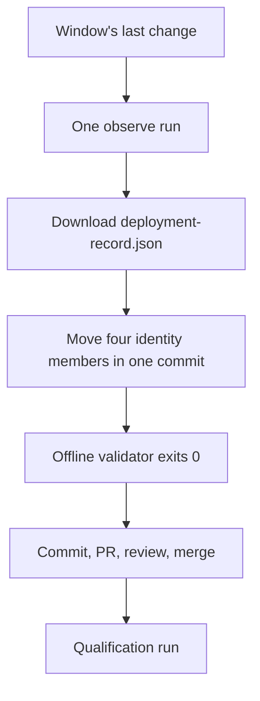

# Moving the system-test compatibility pin

`compatibility.json` is the system-test compatibility contract: it records the deployed identity that Beta qualification accepts. Qualification refuses an environment whose live tuple no longer matches it, so the pin has to move when the deployed tuple moves.

This is the routine that moves it — the owner, the start condition, the single observation that supplies the values, the offline check that must pass before the commit exists, and the qualification run that qualifies the merged pin. It is written so a maintainer can perform a move without rediscovering the procedure, and every step names the command to run or the exact field to read.

## Who owns moving it

The owner is the **`AnyWear-E2E` maintainers**. For one move, the owner is the **E2E maintainer accountable for the change that moved the deployed tuple** — the maintainer whose reviewed change produced the deployed tuple. That maintainer also merges the pin commit, so one accountable person carries both the change and the pin that describes it.

Two people are **not** the owner:

- the Infra operator who dispatches the observation — dispatching supplies evidence, it does not supply ownership;
- whoever runs qualification next — qualification consumes the pin, it does not decide it.

A hand re-pin with no work item behind it is **not permitted**. It has no owner, no review, and no record of where its values came from. A tuple that changed with nothing carrying it is a finding: qualification on that environment stops, and the move waits for a work item that owns the change.

The window closes only on the user's word. The observation is a user-authorised action, so nobody infers that the batch is finished because work went quiet.

## When the routine starts

The routine starts when a deployment, a configuration or admission window, or a recovery changed the deployed tuple while no qualification was in flight.

Nothing fails at that moment. The environment is serving a coherent, working tuple and only the evidence path is stale. The failure surfaces the next time qualification is attempted, as a mismatch against a pin that describes the tuple that used to be deployed.

**A Client publish counts.** Qualification compares the Client first and fails with `Deployed Client does not match compatibility.json`, so a Client published after the observation re-stales `client.sha` on its own, even when Service and Infra did not move at all.

## Order of operations

1. **Observe once**, after the window's last change, with a `runtime.yml` `observe` run. It is user-authorised, and it is not a suite run: the observation reads the deployed tuple and writes the record; it does not test it.
2. **Download that run's artifact**, `infra-deployment-<run_id>-<run_attempt>`. It contains exactly one file, `deployment-record.json`.
3. **Move the four identity members in one commit**, each value read from that record.
4. **Validate offline.** The offline validator must pass before the commit exists.
5. **Commit, open the PR, review, merge.** The PR states, for each of the four members, the source it came from and the value: the table in this document is not the change, so a reviewer must be able to check the values against the record without reading the table.
6. **Record the evidence on the work item that owns the move**: the observation run, the pin commit and the qualification run.

Never one member at a time.



## Where each member is read from

Field paths are inside the downloaded `deployment-record.json`.

| Member | Field path | Operation |
| --- | --- | --- |
| `service.sha` | `observed.service_sha` | The Service commit the observation read at `/health`; the record binds it to the selected image. |
| `service_artifacts.release_id` | `selection.release.id` | The release the observation verified and downloaded. |
| `service_artifacts.manifest_asset_id` | `selection.release.manifest_asset_id` | The `service-artifacts.json` asset of that release. |
| `service_artifacts.manifest_sha256` | `selection.release.manifest_sha256` | The exact bytes of that asset. |
| `infra.sha` | `infra.sha` | The observing run's own revision. The record also carries it as `schema.verification.source_sha`, and the record contract requires the two to be equal, so the record cannot disagree with itself. |
| `deployment.run_id`, `deployment.run_attempt` | `infra.run_id`, `infra.run_attempt` | The run page's identity and attempt. |
| `deployment.artifact_id` | **not in the record** | The artifact named `infra-deployment-<run_id>-<run_attempt>` on that run's page, read by hand. It appears nowhere in the record. |
| `deployment.record_sha256` | the SHA-256 of the downloaded file's bytes | `sha256sum deployment-record.json`. The producer writes single-line canonical JSON, so reformatting the file changes the hash. |
| `client.sha` | `observed.client_sha` | The **deployed** Client the observation read at `/build-metadata.json`. |

## `client.sha` follows the deployed Client

`client.sha` moves only when the record's `observed.client_sha` differs from the pinned value. Movement on Client `main` is not a reason: the pin binds deployed identity, not source, and a reviewed Client commit that was never published is not the deployed Client.

`assertDeploymentBinding` enforces exactly this. The record's `observed.client_sha` must equal the pinned `client.sha`, so a pin that follows Client source instead of the deployed Client fails before any suite runs.

## The four-member rule

A pin describes one tuple, and the tuple has four parts: a Service revision, the immutable release that produced the image it runs, the Infra revision whose observer read it, and the run whose record says so. One tuple, with no partial form.

> A change that moves one of these without the others leaves the pin describing a tuple that was never deployed. It will not pass, and it must not be committed.

Three places bind it, by symbol:

| Code | What it binds |
| --- | --- |
| `assertDeploymentBinding` in `scripts/trusted-deployment-inputs.mjs` | Begins with the exact v2 key-set validation, then binds the record's `infra.sha`, the selected release, `observed.service_sha`, `observed.client_sha` and the run/attempt to the pin. |
| `validateInfraEvidence` in `scripts/qualification-record.mjs` | Re-asserts the same tuple at qualification time, on both observations. |
| the rest of `scripts/trusted-deployment-inputs.mjs` | Refuses an expired or differently shaped artifact before the suite. |

## What is not a substitute

Each of these is occasionally offered as a way to move the pin without the observation. None of them is one.

- **A read-only state check.** A `beta-observe.yml` `state` run is read-only, is excluded from the qualified workflow set and uploads no deployment record. **A read-only state check is not a substitute for the observation.**
- **The deployment workflow's own record artifact.** A deployment, lifecycle, schema or admission run also uploads an `infra-deployment-<run_id>-<run_attempt>` artifact, but its `record_type` is `anywear_infra_family_observation` and the binding refuses it by type. Only `runtime.yml` emits `anywear_infra_deployment`.
- **A hand-edited record.** Editing a field so the values fit dies on the byte hash: `deployment.record_sha256` is the hash of the downloaded bytes, and the validator compares bytes before it parses anything.
- **The v1-only tools.** `scripts/migrate-compatibility.mjs` and `scripts/build-v2-candidate.mjs` are both v1-only and refuse the committed v2 pin.
- **`pnpm check`.** On its own it validates the pin's shape, never its agreement with a record.

## Choosing the observation's inputs

`runtime.yml` fixes its operation to `observe` and takes four dispatch inputs:

| Input | Meaning |
| --- | --- |
| `selection_file` | The committed canonical selection path in the observing Infra revision |
| `selection_sha256` | The exact raw hash of that committed selection |
| `stack_sources_file` | The reviewed per-stack producer source path |
| `stack_sources_sha256` | The exact raw hash of that file |

Both files must be **committed to reviewed Infra `main`**, because the run compares the dispatched hashes against the committed bytes and refuses a mismatch.

Three traps:

- **The default selection is the historical tuple.** The default `selection_file` is `selections/beta-baseline.json`, which still pins the historical tuple (release `407218593`, Service `ab211c82…`), so accepting the default fails.
- **`@executor` is the run's own revision.** `@executor` resolves to the observation run's own `GITHUB_SHA`, and `runtime.yml` only dispatches on `refs/heads/main`, so every unchanged stack must name its real producer explicitly and only the changed stack may be `@executor`.
- **The artifact id is read by hand.** `deployment.artifact_id` is on the run page, never in the record.

Take the observation at the deployment's own Infra revision: dispatch it while `main` is still at the revision that produced the deployed stacks, because the run's `GITHUB_SHA` is whatever `main` is at dispatch time, and `infra.sha` comes from it.

The record artifact is retained for ninety days and the binding refuses an expired one, so the pin must move while its record still exists. `observe` is task-mutating but state-preserving: it needs the activation gate on (`ENABLE_BETA_DEPLOY`) and both Beta stacks active, and it needs no Beta admission.

## The offline validator

`scripts/validate-compatibility-pin.mjs`, exposed as `pnpm compatibility:pin`. No token, no network, no AWS.

```bash
node scripts/validate-compatibility-pin.mjs \
  --deployment-record .qualification-inputs/deployment-record.json \
  --previous .qualification-inputs/previous-compatibility.json
```

`--compatibility` defaults to the committed `compatibility.json` beside the script rather than to the working directory, so the check reads the reviewed pin wherever it is invoked.

What it asserts, in order:

1. The record's byte hash equals `deployment.record_sha256`. The file is read as bytes and never re-serialised, pretty-printed or parse-then-hashed.
2. `assertDeploymentBinding` holds — including the exact v2 key-set check and every tuple binding above.
3. `validateDeploymentRecord` holds, including `schema.verification.source_sha === infra.sha`.
4. Against the previous pin: the pin moved (at least one of `client`, `service`, `infra`, `service_artifacts`, `deployment` changed) and moved forward — a greater `run_id`, or the same `run_id` with a greater `run_attempt`.

The documented hole: `deployment.artifact_id` appears nowhere in the record, so no offline input constrains it. The other properties only the live GitHub API can supply are out of reach here too: the run's conclusion, branch, dispatch type and head, the artifact's name and lifetime, the release's immutability and the manifest bytes. Those stay enforced at qualification time by `scripts/trusted-deployment-inputs.mjs`.

It is **not a gate**. The validator does not join `pnpm check`; only its test joins the `test:core` list that `pnpm check` already runs. There is no new workflow, no new required check and no new release gate. Green means the pin is coherent with the record and with the previous pin — **coherence, not authority**.

## Checklist

One pass, end to end. Every step carries the command or the exact field to read.

1. Confirm the move has an owner and the window is over; the window closes only on the user's word. If either is missing, stop.
2. From a checkout of reviewed Infra `main`, read the four dispatched hashes: `sha256sum selections/<selection>.json stack-sources/<stack-sources>.json`. Both files must already be committed to reviewed Infra `main`.
3. Dispatch the observation: `gh workflow run runtime.yml --repo git-malu/AnyWear-Infra --ref main -f selection_file=selections/<selection>.json -f selection_sha256=<hash> -f stack_sources_file=stack-sources/<stack-sources>.json -f stack_sources_sha256=<hash>`. Only the changed stack may name `@executor`.
4. Wait for that run to succeed and note its id and attempt: `gh run list --repo git-malu/AnyWear-Infra --workflow runtime.yml --limit 1`.
5. Download the record: `gh run download <run_id> --repo git-malu/AnyWear-Infra --name infra-deployment-<run_id>-<run_attempt> --dir .qualification-inputs`. It contains exactly one file, `.qualification-inputs/deployment-record.json`.
6. Read the hash of its bytes: `sha256sum .qualification-inputs/deployment-record.json`. That is `deployment.record_sha256`; never reformat the file.
7. Read the members: `jq '{service: .observed.service_sha, client: .observed.client_sha, release: .selection.release, infra: .infra.sha, run: [.infra.run_id, .infra.run_attempt]}' .qualification-inputs/deployment-record.json`.
8. Read the artifact id from the run page: `gh api repos/git-malu/AnyWear-Infra/actions/runs/<run_id>/artifacts --jq '.artifacts[] | select(.name == "infra-deployment-<run_id>-<run_attempt>") | .id'`. That is `deployment.artifact_id`, and it is the one member no offline input can check.
9. Save the pin as committed before the change: `git fetch origin`, then `git show origin/main:compatibility.json > .qualification-inputs/previous-compatibility.json`.
10. Move `service.sha`, the three `service_artifacts` fields, `infra.sha` and the four `deployment` values (`run_id`, `run_attempt`, `artifact_id`, `record_sha256`; `repository` and `workflow_path` stay) in one commit; leave `version` and, unless the record says otherwise, `client.sha` alone.
11. Run the validator and require exit 0: `node scripts/validate-compatibility-pin.mjs --deployment-record .qualification-inputs/deployment-record.json --previous .qualification-inputs/previous-compatibility.json`.
12. Commit, open the PR, review and merge; the PR states the source and value of each of the four members and links the observation run. Record the observation run and the pin commit on the work item that owns the move.
13. Run qualification on the merged pin: `gh workflow run beta-qualification.yml --repo git-malu/AnyWear-E2E --ref main -f worker_slot_offset=<first of an unused captured worker-slot pair>`. Record that run's id on the same work item, so the move, the pin and the qualification are one trail.

Do not move one member at a time — the four identity members move in one commit.

Do not move `client.sha` unless the record's `observed.client_sha` differs from the pin; Client `main` moving is not a reason.
