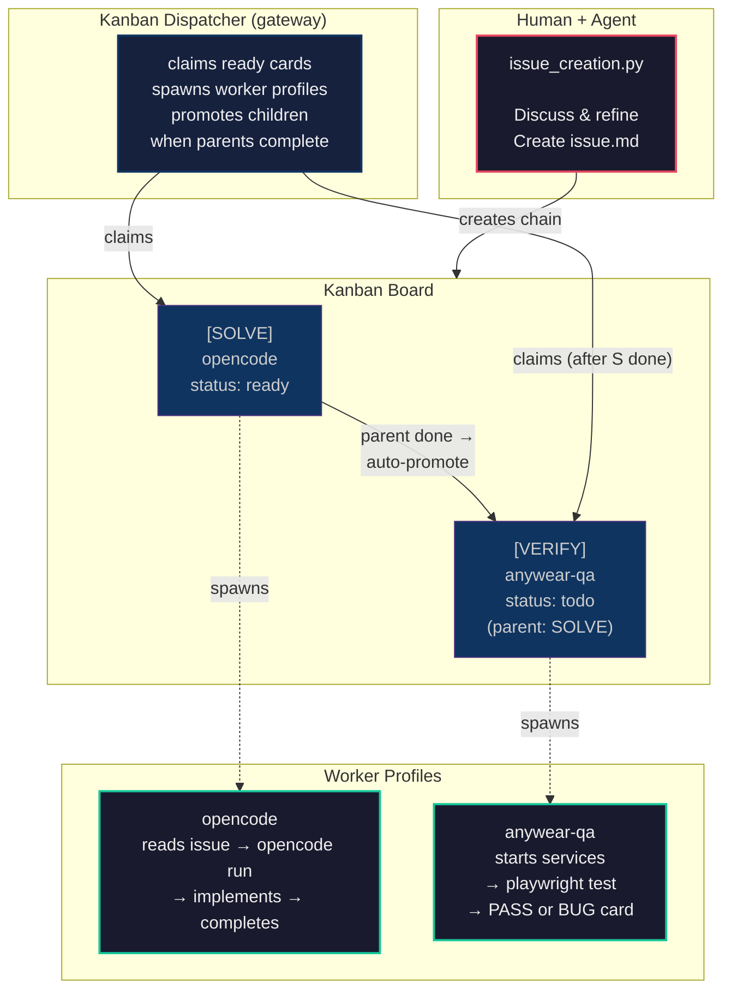
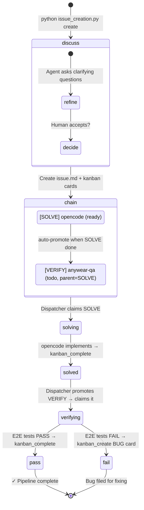

# AnyWear DevOps Pipeline

Agent-driven development workflow that automates the full lifecycle:
**Propose → Implement → Verify** using Hermes Agent profiles and kanban
dependency gating. No cron jobs, no polling scripts, no dual drivers —
the kanban dispatcher owns the state machine; we just define the graph.

## Architecture



## How It Works

There is exactly **one driver**: the kanban dispatcher running inside the gateway.
We don't poll, we don't cron, we don't watch. We create a dependency graph and
the dispatcher walks it.

```
issue_creation.py creates TWO cards linked by --parent:

  t_abc123 [SOLVE] Dark mode     ← assigned to opencode, status: ready
       │
  t_def456 [VERIFY] Dark mode    ← assigned to anywear-qa, parent: t_abc123
                                   status: todo (gated — won't run until parent done)
```

The dispatcher then:

1. Claims `t_abc123` → spawns `opencode` worker → worker calls `kanban_complete()`
2. Sees parent done → auto-promotes `t_def456`: todo → ready
3. Claims `t_def456` → spawns `anywear-qa` worker → worker runs E2E tests
4. PASS: `kanban_complete()`. FAIL: creates BUG card + `kanban_complete()`

## Files

| File | Role |
|------|------|
| `devops.py` | CLI: `create` (wraps issue_creation) + `status` |
| `issue_creation.py` | Stage 1 — Human↔agent discussion → issue.md → kanban chain |
| `README.md` | This document |

## Profiles

| Profile | Purpose |
|---------|---------|
| `default` | Orchestrator — runs devops.py, creates issues |
| `opencode` | Coding agent — implements features via OpenCode CLI |
| `anywear-qa` | QA agent — runs E2E tests via @playwright/cli |

## Quick Start

### 1. Ensure the gateway is running

```bash
hermes gateway start
```

The gateway hosts the kanban dispatcher. Without it, `ready` cards stay `ready` forever.

### 2. Create a new issue

From a hermes session:

```
"Create a new issue for dark mode in the wardrobe"
```

Or from the command line:

```bash
python scripts/devops/devops.py create --title "Dark mode for wardrobe" --type feature
```

The agent will discuss the issue with you, refine it, and if accepted:

1. Create an issue file at `AnyWear-Meta/issues/features/dark_mode_for_wardrobe.md`
2. Create a 2-card kanban chain:
   - `[SOLVE] Dark mode for wardrobe` → assigned to `opencode`
   - `[VERIFY] Dark mode for wardrobe` → assigned to `anywear-qa`, waits for SOLVE

### 3. Watch it flow — automatically

```
python scripts/devops/devops.py status
```

No further action needed. The dispatcher drives both stages.

## Kanban Flow (State Diagram)



## Card Body Templates

The `issue_creation.py` script generates card bodies that are self-contained
worker instructions. Workers dispatched by kanban read their card body and
follow the instructions — no external coordination needed.

### [SOLVE] card body (opencode worker)

- Path to the issue file
- Scope (which repos are affected)
- Instructions: read issue → opencode run → verify tests/lint/build → commit → kanban_complete

### [VERIFY] card body (anywear-qa worker)

- Path to the issue file and parent task ID
- Instructions: read parent summary → start services → playwright test
- PASS: kanban_complete with evidence
- FAIL: kanban_create bug card + kanban_complete with bug reference

## Issue File Format

Issues are created in `AnyWear-Meta/issues/{features,bugs}/` as markdown files
with YAML frontmatter:

```markdown
---
status: backlog
created: 2026-05-30
scope: AnyWear-Client
---

# Dark Mode for Wardrobe

Description of the feature...

## Acceptance Criteria

- [ ] TBD — refine during implementation
```

## Dependencies

- Hermes Agent with kanban support
- Gateway running (`hermes gateway start`) — hosts the dispatcher
- 3 profiles: `default`, `opencode`, `anywear-qa`
- OpenCode CLI (`opencode`) for the opencode profile
- `@playwright/cli` for QA testing
